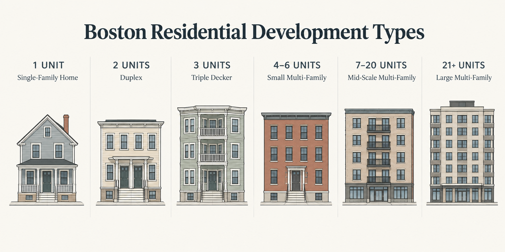

# boston_zoning_sim

A parcel-level simulator to test how residential real estate prices and developers respond to zoning changes. The simulator has three steps:
1. Simulate the Policy: Change a neighborhood's zoning variable
2. Calculate Revenues: Use the Hedonic Model to calculate expected market value of different building typologies at the parcel level
3. Predict Developer Choices: Use simulated revenue and zoning variables in the Developer Choice Model to predict the probability shift in development choices

###
The simulator predict real estate prices for each Boston typology that could be built on a parcel. Those prices are used to predict the developer decisions. The residential typologies for the developer choice are:

## Running a Simulation

### Run Data Pipeline
Run `python preprocessing/run_panel_prep.py` to build both model inputs (see `preprocessing/README.md`):
- `processed_data/hedonic_input.parquet` — parcel-year panel (FY2016–FY2025) 
- `processed_data/devchoice_input.parquet` — five pooled 1-year cross-sections 

### Run Simulation
- modify zoning in the configuration file
- Run in CLI

### Semi-causal structural model, ML validation framework
Traditional statistics and machine learning are used to harness both explanatory and predictive power.
- A structural econometric model allows for observing the impact of zoning changes. Model coefficients are statistically valid to help explain predictions
- Cross validation of results is done using spatially stratified spatial splits to ensure all neighborhoods are accounted for in training and testing data

### Demand (Revenue Calculation)
- A standard **OLS hedonic model** is used to predict the value of different residential development types on a particular parcel. That spatio-temporal lag variable in the model predicts **price per square foot** to feed into developer revenue calculations. It uses property attributes alongside others to address statistical needs:
    - **Spatio-temporal price lag** is included through a **temporal precedence** variable by calculating a running average of price per sqft within **300 m** of the parcel using only sales that occurred prior to the transaction date. This stops the simultaneous feedback loop so that only past sales influence current price.
    - **Accessibility and neighborhood variables** reduce omitted variable bias (reducing endogeneity) and mitigate the risk of spatial autocorrelation influencing price estimates.These variable handle spatial error.
    - **Yearly transaction dummies** remove temporal endogeneity by absorbing time-varying macroeconomic shocks.    - **Property attributes** describe the components of the property itself that influence its price.

### Supply (Developer Choice)
#### Model Form
- **Multinomial Logit** is used here to help account for unobserved factors and risks in development decisions. While financial feasibility can be used deterministically and is essential to the construction of residential development, the likelihood of development occurring is known to be influenced by numerous additional difficult-to-capture constraints. 
- **Nested Logit Model** is specifically used to handle the unobserved traits of different development cases - A developer first decides if they want to build (option 1- no change to the parcel), and then decides the density (additional nested options). Nesting groups with similar building types absorbs hidden construction and permitting costs, in lieu of proprietary construction cost data. Macro construction cost changes are also absorbed in the hedonic's time fixed effects while micro niehgborhood-related development.
#### Parameters
- **Market price** from the hedonic model is fed into the developer choice model to calculate the predicted revenue based on typology, while the current building on the parcel provides the **aquisition cost**.
- **Zoning** tracks how much influence the documented zoning has on final development desnity probabilities.Boston has a historically high residential variance rate, meaning that the zoning permitted on paper does not necessarily get used by the developer. Zoning is a developer choice variable instead of using a zoning filter to select density options in the simulator.
- **Accessibility and neighborhood variables** absorb unobserved spatial clustering. Including a neighborhood dummy captures macro-level spatial sorting, localized construction cost differences, and community pushback. Neighborhood and accessibility like transit availability are important to capture because they can represent neighborhood demand, which if ommitted will not let the effect of zoning changes be isolated, but rather endogenous since zoning can happen where demand is.
- **Spatially lagged development activity** is used (prior to the developer choice data window) to capture micro-level agglomeration and real estate momentum: development events within **600 m** of the parcel, pooled prior to the choice data, creating clean temporal exogeneity.
- **Parcel size** (lot SF) scales the revenue potential of each typology and constrains which densities are feasible on the parcel.

### Time scale
- Five years of parcel development data are used in the model produce a five year forecast. Year-to-year land use changes are stacked into a pooled cross-sectional dataset. The five year scale reflects the average development cycle. The spatio-temporal variable in the developer model looks at the development that occurred around the parcel in the prior three years.
- The hedonic model is a compilation of 10 years of transaction data. The last five years overlap with the developer decision window, meaing the yearly transaction dummies can map macroeconomic shocks (like the 2020–2022 pandemic shifts or interest rate hikes) across both models simultaneously. The temporal precedence variable ensures developer choices are only based on past data. 

